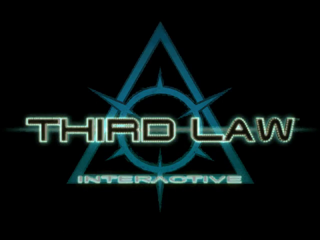
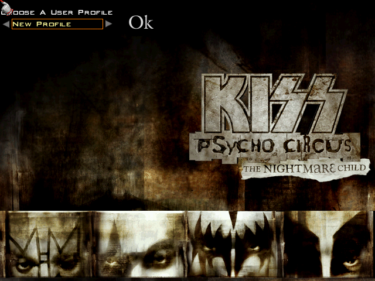
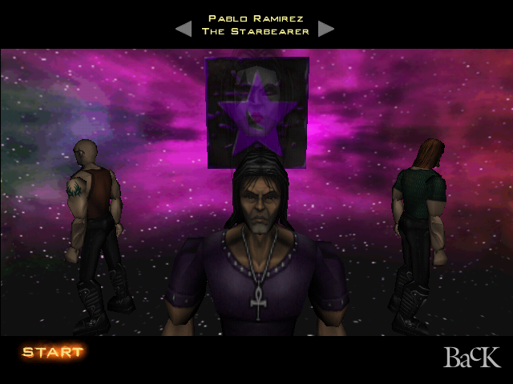
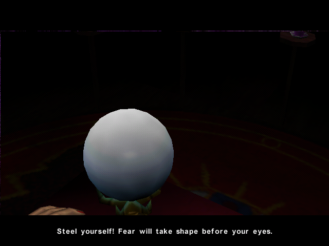

# KISS Psycho Circus: The Nightmare Child — Static Recompilation


## What it is

A static recompilation of **KISS Psycho Circus: The Nightmare Child** (Third
Law Interactive, 2000), a LithTech 2 first-person shooter, from its shipping
Windows binaries (the 1.13 patch) to native C. No emulator, no wrapper DLLs.

Built on the [pcrecomp](https://github.com/sp00nznet/pcrecomp) toolchain and
following its shared house style (layout, CLI, headless mode); the
conformance harness is not here yet ([ROADMAP.md](ROADMAP.md)). It started
from the [Shogo recomp](https://github.com/sp00nznet/shogo-recomp), the first
LithTech game; [docs/lithtech.md](docs/lithtech.md) says what carried over
from LithTech 1 to 2.

Every module that runs Monolith's or Third Law's code is lifted to C with
pcrecomp's own disassembler and lifter, compiled with MSVC and linked into
one 32-bit host on pcrecomp's `native32` runtime, which calls the real
DirectDraw, Direct3D, DirectInput and Miles:

| Module | What it is | Functions |
|---|---|---|
| `client.exe` | the LithTech 2 engine | 4,857 |
| `d3d.ren` | the Direct3D renderer | 1,481 |
| `server.dll` | the local server | 2,813 |
| `cshell.dll`, `cres.dll` | the client game code and its resources | 8,476 + 100 |
| `object.lto`, `sres.dll` | the server game code and its resources | 9,846 + 100 |
| `cdaudio.dll` | Third Law's CD audio | 821 |

All of them were linked at `0x10000000` (`cshell.dll` at `0x20000000`), so
`tools/rebase.py` relocates them to fixed bases first, and the host answers
each `LoadLibrary` with the lifted module. Third-party DLLs (`mss32.dll`,
`smackw32.dll`, `ima.dll`, `de_msg.dll`) load natively.

**Nothing from the game is in this repository, and no generated source.** You
supply your own copy; the lifted C is generated on your machine into the
gitignored `src/recomp/gen/`.

## Status: v0.1.0-dev, early. A new game runs through the menus into the intro of the first level, in the recompiled code.

| Stage | State |
|---|---|
| Version recompiled | 1.13 (`client.exe` stamp `0x3A831A25`, February 2001), from the US CD + the 1.1 and 1.10-to-1.13 patches |
| Lift | 8 modules, 28,494 functions, 0 errors (pcrecomp `rtti.py` + `disasm32.py` + `lift32`, no IDA) |
| Host (`build/kiss.exe`, 32-bit, `native32`) | every import bound (dry run: 0 unresolved in all 8 modules); the generated C builds at `/Od` in under a minute |
| Boot: rez trees, the game DLLs, DllMains | works |
| Renderer: `d3d.ren`, windowed | works on Direct3D's RGB software rasterizer (`+RGBRast 1`), 16-bit (the host relaunches itself under `16BITCOLOR`). The hardware path is untested |
| Third Law logo, profile screen, main menu | works |
| New Game, difficulty, character select | works, driven by `--key` |
| First level | loads (`object.lto`); the in-engine intro plays (Madam Raven's crystal ball, captions) |
| Playing it (moving, firing) | not yet: in-game controls read DirectInput, which the headless harness cannot feed yet ([ROADMAP.md](ROADMAP.md)) |
| Sound | Miles (`mss32.dll`); runs so far are muted (`+soundenable 0`) |
| Headless (`--headless --record out.mp4`) | works: a private desktop, back-buffer screenshots, ffmpeg recording |
| Toolkit | needs pcrecomp's `pcrecomp-lithtech2` branch, not yet in `main` |
| Setup.cmd, launcher | written; Setup tested from a fresh clone (see Getting Started) |
| Conformance harness | none yet; the dry run (`build\kiss.exe`, no `--run`) is the only automatic check |
| netlab | recipe `kiss-recomp` (generated C at `/Od`), no QA step, not yet built on the farm (the test VM was unreachable) |

## Screenshots

Real output of `build\kiss.exe --headless --run ... --shot`, recompiled code
throughout (`d3d.ren`'s back buffer, 640x480):

| | |
|---|---|
|  |  |
|  |  |
|  |  |

## Getting Started

You need **your own copy of KISS Psycho Circus: The Nightmare Child** (the US
CD), patched to 1.13:

1. Copy the CD's `Psycho` folder somewhere (no installer has to run).
2. Get the two official US patches from archive.org's Game Patches and Fixes
   Archive (`video-game-patches_k`, folder *KISS Psycho Circus - The
   Nightmare Child*): `patch 1.1/US/kiss11us.zip` and
   `patch 1.10 to 1.13/US/kpc110us113.zip`.
3. Run `kpcptch11.exe`, then `kpcptch_US_110_to_113.exe`, **from inside the
   game folder** (they patch their working directory when the CD install's
   registry key is missing). From a command prompt in that folder:
   ```
   set __COMPAT_LAYER=RunAsInvoker
   D:\patches\kpcptch11.exe
   D:\patches\kpcptch_US_110_to_113.exe
   ```
   (`RunAsInvoker` stops Windows asking for administrator rights because of
   the file name.) Each says "Patching was successful". The folder then holds
   `client.exe` and `KPCPatch.rez`.

Nothing is downloaded for you.

### Quick start: Setup.cmd

1. Download this repository (the green **Code** button, then **Download ZIP**)
   and unzip it somewhere with 3 GB free.
2. Double-click **`Setup.cmd`**.

It checks for Python 3.10+, the `pefile` and `capstone` packages, the pcrecomp
toolkit (cloned on its `pcrecomp-lithtech2` branch if missing) and the Visual
Studio 2022 C++ compiler, and **asks** before installing any of them, saying
what and how big. It looks for the game in the usual folders, or asks where it
is (`Setup.cmd -GameDir D:\Games\Psycho` skips the question, `-Yes` answers
yes to every install). Then it links that folder as `game`, relocates the
modules, finds every function, recompiles them and builds `build\kiss.exe`. A
rerun skips the finished steps. If it stops, it says why in one sentence, and
the details are in `setup.log`.

It ends with a **`KISS Psycho Circus`** shortcut in the folder
(`build\kiss.exe --run -- +windowed 1 +RGBRast 1`). Double-click it to play.

### Step by step

Prerequisites: Windows 10/11, **Python 3.10+** (`py -3 --version`), **git**,
**Visual Studio 2022** (or its Build Tools) with *Desktop development with
C++*, ffmpeg on `PATH` for `--record` only, and pcrecomp cloned **beside**
this repository as `pcrecomp`, on the `pcrecomp-lithtech2` branch:

```
some-folder\
  pcrecomp\        <- git clone -b pcrecomp-lithtech2 https://github.com/sp00nznet/pcrecomp
  kiss-recomp\     <- this repository
```

1. Python packages:
   ```
   py -3 -m pip install --user pefile capstone
   ```
2. Point `game` at your 1.13 folder:
   ```
   mklink /J game D:\Games\Psycho
   ```
3. Relocate the modules:
   ```
   py -3 tools\rebase.py
   ```
   Expected, at the end: `cshell.dll   0x20000000-0x201eb000`.
4. The function catalog, all 8 modules in parallel (about a minute):
   ```
   py -3 tools\catalog.py
   ```
   Each module's log is `work\<module>.catalog.log`; the summary line for
   `client.exe` is `[*] Functions: 4857 ...`.
5. Recompile to C, then build (MSVC's 64-bit-hosted x86 compiler, CMake and
   Ninja; all three come with the C++ workload):
   ```
   py -3 run_lift.py
   build.cmd
   ```
   Expected from the lift: `28494 functions in the dispatch table, lift errors 0`.
6. Check it without opening a window:
   ```
   build\kiss.exe
   ```
   Expected: eight `[bind] ... 0 unresolved` lines, then
   `(dry run: mapped and bound; --run enters 0x01D2339C)`.
7. Play: `build\kiss.exe --run -- +windowed 1 +RGBRast 1`.

The usual trip-ups: `python` opening the Microsoft Store (Windows' alias
placeholder; use `py -3`, or turn the alias off in *Settings > Apps > Advanced
app settings > App execution aliases*); a freshly installed Python not on
`PATH` until you open a new window; a pcrecomp on `main` instead of
`pcrecomp-lithtech2`; and a game folder that is not patched (the 1.0
`client.exe` is a different build and is not what `run_lift.py` lifted).

## Usage

```
build\kiss.exe --run -- +windowed 1 +RGBRast 1 +soundenable 0
build\kiss.exe --headless --run --record run.mp4 --watchdog 300 ^
    --key 0x0D@55 --key 0x0D@75 --key 0x0D@95 --key 0x0D@115 --key 0x0D@135 ^
    --key 0x0D@150 --key 0x0D@165 --key 0x0D@180 --shot 260 intro.bmp ^
    -- +windowed 1 +RGBRast 1 +soundenable 0
```

The second line is the scripted path into the first level, headless: Enter
past the intro movies, on New Profile, OK on the name "Player", Game, New
Game, Lullaby, Pablo Ramirez, Start.

| Flag | |
|---|---|
| `--run` | enter the game (without it: map, bind and stop) |
| `--headless` | run on a private desktop that is never shown (works over RDP) |
| `--record FILE.mp4` | every presented frame to ffmpeg |
| `--shot S FILE.bmp` | save `d3d.ren`'s back buffer at S seconds (up to 8) |
| `--key VK@S` | press a virtual key S seconds in (posted `WM_KEYDOWN`; also `SendInput` when not headless) |
| `--watchdog S` | stop after S seconds and say where every thread was |
| `--game DIR` | the game folder (default `game`) |
| `--rebased DIR` | the relocated modules (default `work\rebased`) |
| `--no-16bit` | skip the relaunch under the `16BITCOLOR` compatibility layer |
| `--trace-at S` | one second of the native-call trace at S seconds |
| `--native-trace`, `--callbacks` | one line per call into Windows, or back from it |
| `--heap-check` | validate every heap at each guest heap call |
| `--native MODULE` | run a module's original machine code (bisecting) |
| `--di-probe` | DirectInput's device enumeration from host C, nothing else |
| `-- ...` | everything after goes to the engine (`+windowed 1`, `+RGBRast 1`, ...) |

## Building from source

Steps 3 to 5 above. `PCRECOMP` (Python) and `-DPCRECOMP=` (CMake, through
`set CMAKE_ARGS=...` for `build.cmd`) point at a toolkit checkout other than
`..\pcrecomp`; the lifter and the runtime must come from the same tree. The
generated C builds at `/Od` by default (`-DGEN_OPT=/O2` for a faster game and
a much longer build). On the farm: `netlab build kiss-recomp`. What the game
needed, in the order it turned up, is [docs/bringup.md](docs/bringup.md).

## Credits

Started from the [Shogo recomp](https://github.com/sp00nznet/shogo-recomp),
whose loader came from the [Unreal Tournament recomp](https://github.com/sp00nznet/ut99-recomp),
on [pcrecomp](https://github.com/sp00nznet/pcrecomp)'s `native32` runtime.
See [NOTICE](NOTICE).

## License

MIT, for the code in this repository ([LICENSE](LICENSE); attributions in
[NOTICE](NOTICE)). KISS Psycho Circus: The Nightmare Child is © Third Law
Interactive and Gathering of Developers, LithTech © Monolith Productions;
none of it is here.
