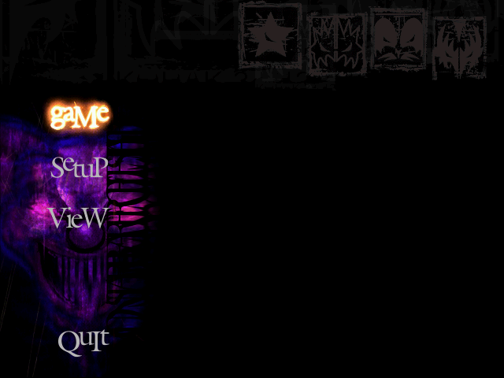
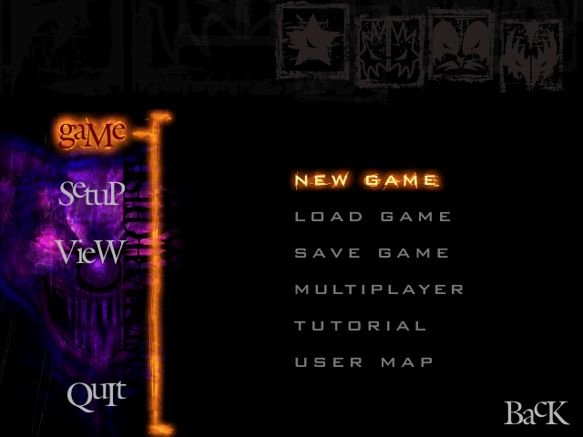
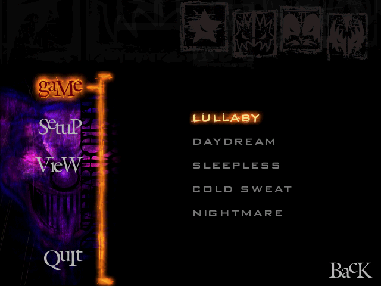
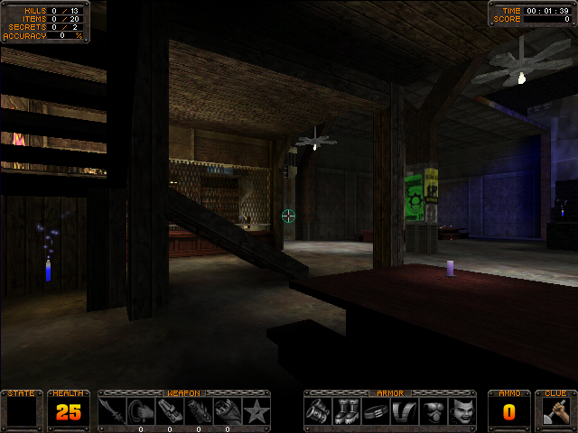
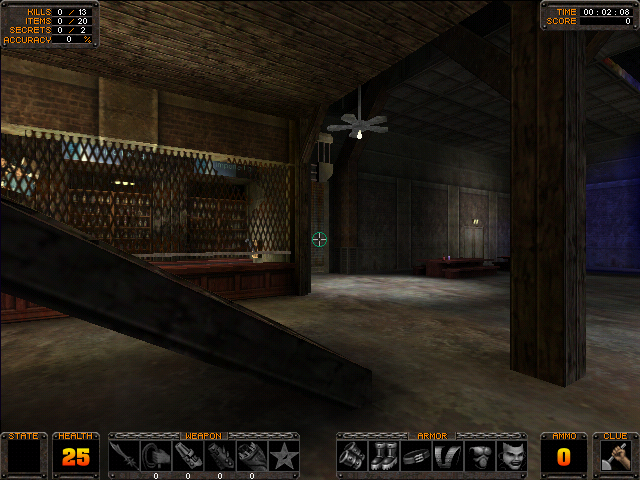

# KISS Psycho Circus: The Nightmare Child — Static Recompilation

Static recompilation of **KISS Psycho Circus: The Nightmare Child** (Third
Law Interactive, 2000), a LithTech 2 first-person shooter, from its shipping
Windows binaries (the 1.13 patch) to native C. Every module that runs
Monolith's or Third Law's code is lifted to C with pcrecomp's own
disassembler and lifter, no IDA, and linked into one 32-bit host that calls
the real DirectDraw, Direct3D, DirectInput and Miles. No emulator, no wrapper
DLLs.

Built on the [pcrecomp](https://github.com/sp00nznet/pcrecomp) toolchain,
on its `main` branch. It started
from the [Shogo recomp](https://github.com/sp00nznet/shogo-recomp), the first
LithTech game; [docs/lithtech.md](docs/lithtech.md) says what carried over.

## Getting Started

You need **your own copy**: the US CD's `Psycho` folder, patched to 1.13 with
the two official US patches ([docs/building.md](docs/building.md#the-game-folder)
says how). Nothing from the game is in this repository or downloaded for you;
everything is built on your machine from your copy.

### The setup scripts

1. Download this repository (the green **Code** button, then **Download ZIP**)
   and unzip it somewhere with 3 GB free.
2. Double-click **`Setup.cmd`** (`Setup.cmd -GameDir D:\Games\Psycho` skips
   the question, `-Yes` answers yes to every install).
3. Play with the **`KISS Psycho Circus`** shortcut in that folder.

The script asks before installing anything (Python 3.10+, `pefile` and
`capstone`, git, the Visual Studio 2022 C++ Build Tools), clones pcrecomp
beside this folder, links your game folder
as `game`, and relocates, catalogs, lifts and builds the 8 modules into
`build\kiss.exe`; about 15 minutes once the tools are there. A rerun skips
finished steps; if it stops, it says why, and the details are in `setup.log`.
Building by hand is in **[docs/building.md](docs/building.md)**.

Windows only for now: there is no Linux or macOS build (the host is on
`native32`, which calls the real Windows DirectX), so there is no `setup.sh`.

## Status

**v0.1.0-dev, early.** A new game runs through the menus and the intro into
the first level, and the player moves, turns and jumps there, in the
recompiled code. Firing, the mouse and sound are untried.

| Module | What it is | Functions |
|---|---|---|
| `client.exe` | the LithTech 2 engine | 4,857 |
| `d3d.ren` | the Direct3D renderer | 1,481 |
| `server.dll` | the local server | 2,813 |
| `cshell.dll`, `cres.dll` | the client game code and its resources | 8,476 + 100 |
| `object.lto`, `sres.dll` | the server game code and its resources | 9,846 + 100 |
| `cdaudio.dll` | Third Law's CD audio | 821 |

| Stage | State |
|---|---|
| Version recompiled | 1.13 (`client.exe` stamp `0x3A831A25`, February 2001), from the US CD + the 1.1 and 1.10-to-1.13 patches |
| Lift | 8 modules, 28,494 functions, 0 errors (pcrecomp `rtti.py` + `disasm32.py` + `lift32`, no IDA) |
| Host (`build/kiss.exe`, 32-bit, `native32`) | every import bound (dry run: 0 unresolved in all 8 modules); the generated C builds at `/Od` in under a minute |
| Boot: rez trees, the game DLLs, DllMains | works |
| Renderer: `d3d.ren`, windowed | works on Direct3D's RGB software rasterizer (`+RGBRast 1`), 16-bit (the host relaunches itself under `16BITCOLOR`). The hardware path is untested |
| Third Law logo, profile screen, main menu | works |
| New Game, difficulty, character select | works, driven by `--key` |
| First level | loads (`object.lto`); the in-engine intro plays (Madam Raven's crystal ball, captions) |
| Playing it | **moving, turning, jumping** in the first level, headless: `--key` feeds pcrecomp's synthetic DirectInput keyboard. Firing and the mouse are untried |
| Sound | Miles (`mss32.dll`); runs so far are muted (`+soundenable 0`) |
| Headless (`--headless --record out.mp4`) | works: a private desktop, back-buffer screenshots, ffmpeg recording |
| Toolkit | pcrecomp `main`; Setup clones and checks it |
| Setup.cmd, launcher | Setup.cmd runs from a fresh clone to the shortcut (16 minutes on 2026-11-12, cloning pcrecomp-ingame itself; Python and the compiler were already there); the launcher is untested and there is no installer release |
| Conformance harness | none yet; the dry run (`build\kiss.exe`, no `--run`) is the only automatic check |
| netlab | recipe `kiss-recomp` (generated C at `/Od`), no QA step, not yet built on the farm (the test VM was unreachable) |

[bringup.md](docs/bringup.md) is the log of each wall and its fix, and
[ROADMAP.md](ROADMAP.md) what comes next.

## Screenshots

Real output of `build\kiss.exe --headless --run ... --shot`, recompiled code
throughout (`d3d.ren`'s back buffer, 640x480):

| | |
|---|---|
|  |  |
|  |  |
|  |  |

| The first level, at the start | after turning right, a jump and walking forward |
|---|---|
|  |  |

## Documentation

- [docs/building.md](docs/building.md): the game folder, building by hand, the options
- [docs/testing.md](docs/testing.md): the dry run, the headless run into the first level, every host flag
- [docs/bringup.md](docs/bringup.md): every wall so far and its fix
- [docs/lithtech.md](docs/lithtech.md): LithTech 1 to LithTech 2, what carried over from Shogo
- [ROADMAP.md](ROADMAP.md), [CHANGELOG.md](CHANGELOG.md), [CONTRIBUTING.md](CONTRIBUTING.md)

## Contributors

See **[CONTRIBUTORS.md](CONTRIBUTORS.md)** for who did what.

## License

MIT for this repository's own code ([LICENSE](LICENSE)). KISS Psycho Circus:
The Nightmare Child is © Third Law Interactive and Gathering of Developers,
LithTech © Monolith Productions; none of their files, and nothing generated
from them, is in this repository ([NOTICE.md](NOTICE.md)).
