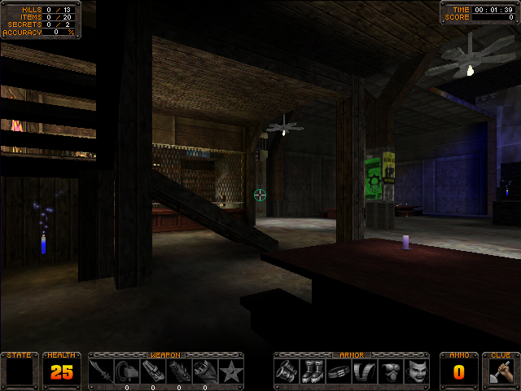
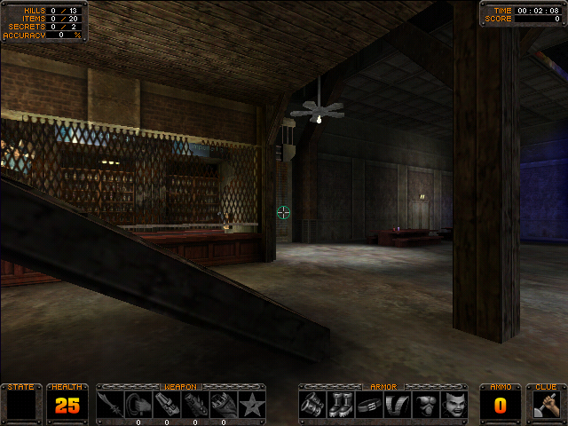

# Testing

There is no conformance harness yet ([ROADMAP.md](../ROADMAP.md)). Two
checks are run by hand:

1. **The dry run**, `build\kiss.exe` with no `--run`: maps and binds all 8
   modules and stops. Expected: eight `[bind] ... 0 unresolved` lines, then
   `(dry run: mapped and bound; --run enters 0x01D2339C)`.
2. **The headless run into the first level**, below: its `--shot` pictures
   should match `docs/screenshots/level1-start.png` and `level1-moved.png`.

Runs are muted (`+soundenable 0`) and `--headless` keeps every window on a
private desktop, so nothing reaches a screen, over RDP or not.

## Scripted input

```
build\kiss.exe --run -- +windowed 1 +RGBRast 1 +soundenable 0
build\kiss.exe --headless --run --record run.mp4 --watchdog 300 ^
    --key 0x0D@55 --key 0x0D@75 --key 0x0D@95 --key 0x0D@115 --key 0x0D@135 ^
    --key 0x0D@150 --key 0x0D@165 --key 0x0D@180 --shot 260 intro.bmp ^
    -- +windowed 1 +RGBRast 1 +soundenable 0
```

The second line is the scripted path into the first level, headless: Enter
past the intro movies, on New Profile, OK on the name "Player", Game, New
Game, Lullaby, Pablo Ramirez, Start.

Into the level and moving: times written `L<S>` count from the first load of
the level's game code (`object.lto`), so they do not drift with the menus.

```
build\kiss.exe --headless --run --watchdog 600 --key 0x0D@55 --key 0x0D@75 ^
    --key 0x0D@95 --key 0x0D@115 --key 0x0D@135 --key 0x0D@150 --key 0x0D@165 ^
    --key 0x0D@180 --key 0x20@L60 --shot L165 start.bmp --key 0x27:1500@L170 ^
    --key 0x20:600@L180 --key 0x45:6000@L190 --shot L194 moved.bmp ^
    -- +windowed 1 +RGBRast 1 +soundenable 0
```

| The first level, at the start | after turning right, a jump and walking forward (`E`) |
|---|---|
|  |  |

## Record and replay

`--key` times are wall-clock seconds, so a slow run presses Enter before the
menu is there. A recording is keyed to the game's own frames instead (the
presents of `d3d.ren`), and under `--record FILE.rec`, `--replay` or
`--keys` the game's clock is virtual: every `timeGetTime`, `GetTickCount`
and `QueryPerformanceCounter` read moves it 1 ms, so frame N comes after the
same work at any load. (The intro movies are Smacker's, native, on the real
clock.)

```
set PCRECOMP_MUTE=1
build\kiss.exe --headless --run --watchdog 900 --replay tests\level1.rec ^
    -- +windowed 1 +RGBRast 1 +soundenable 0
```

[tests/level1.rec](../tests/level1.rec) is the scripted path above, recorded:
into the first level, `start.bmp`, then right, jump, walk, `moved.bmp` (in
the current directory, with a hash per shot), then `end`.

Not yet reliable. Three replays in a row: the first matched the recording's
two menu checkpoints (`m1`, `m2`) hash for hash, then reached a different
in-level frame; the second went its own way from `m1`; the third stalled in
the menus. The clock is one counter that every thread reads (and the native
movies use the real one), so thread interleaving still moves it. Next step:
a clock per guest thread, or one advanced by presents only.

To record, run any `--key`/`--shot` script with `--record FILE.rec` (a
`.mp4` name still records video): each key edge and shot is written as
`FRAME EVENT`. Edit the shot paths to bare names. Keys in frames directly:
`--keys f193900:0x0D,f194000:0x45*40` (`*N` holds N frames, default 8).

| Line | |
|---|---|
| `FRAME key VK down\|up` | a virtual key (hex) |
| `FRAME VK[*N]` | a press, held N frames |
| `FRAME shot FILE` | a checkpoint: the back buffer as .bmp and its FNV hash |
| `FRAME end` | exit |

| Flag | |
|---|---|
| `--run` | enter the game (without it: map, bind and stop) |
| `--headless` | run on a private desktop that is never shown (works over RDP) |
| `--record FILE.mp4` | every presented frame to ffmpeg |
| `--shot S FILE.bmp` (S or `L`S) | save `d3d.ren`'s back buffer at S seconds (up to 8) |
| `--key VK[:MS]@S` | press a virtual key S seconds in, held MS ms (default 250): posted `WM_KEYDOWN`, plus native32's synthetic DirectInput keyboard under `--headless` (`SendInput` otherwise) |
| `--watchdog S` | stop after S seconds and say where every thread was |
| `--game DIR` | the game folder (default `game`) |
| `--rebased DIR` | the relocated modules (default `work\rebased`) |
| `--no-16bit` | skip the relaunch under the `16BITCOLOR` compatibility layer |
| `--trace-at S` | one second of the native-call trace at S seconds |
| `--native-trace`, `--callbacks` | one line per call into Windows, or back from it |
| `--heap-check` | validate every heap at each guest heap call |
| `--native MODULE` | run a module's original machine code (bisecting) |
| `--di-probe` | DirectInput's device enumeration from host C, nothing else |
| `-- ...` | everything after goes to the engine (`+windowed 1`, `+RGBRast 1`, ...) |
